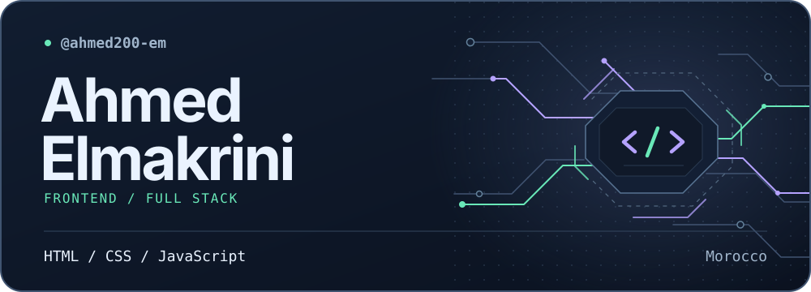
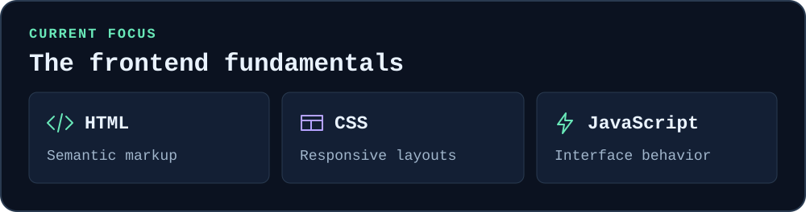
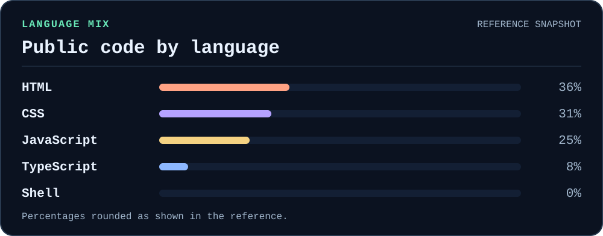
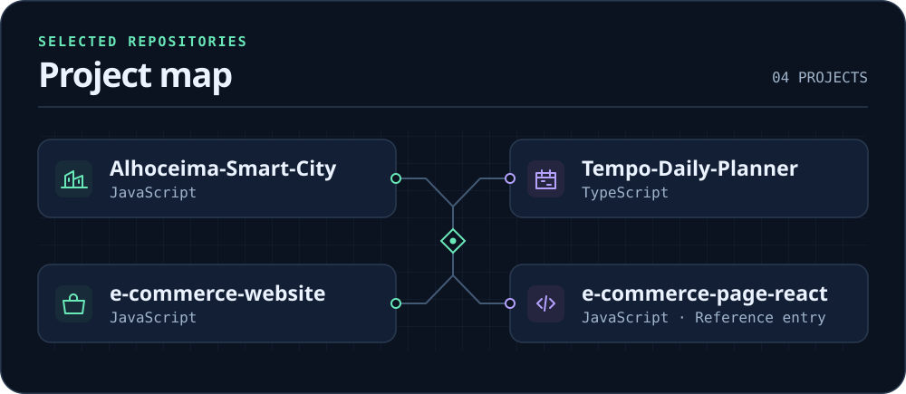
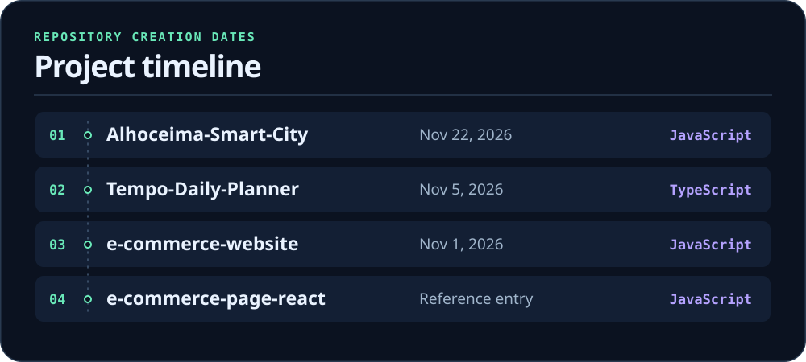
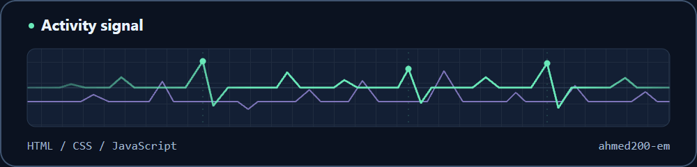
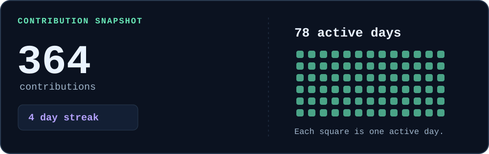
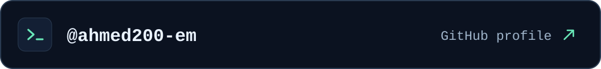

  

<strong>Frontend or full-stack engineer</strong> · Morocco

  I build web interfaces and applications, from a civic portal for Al Hoceima to a daily planner and a fragrance storefront.

<a href="https://github.com/ahmed200-em">GitHub</a> · <a href="#built-shipped-shared">Selected projects</a>

---

## Identity, with signal

I'm a web developer, full-stack developer, and cyber engineer. My background includes three years of university study and a cybersecurity certification. I focus on **HTML**, **CSS**, and **JavaScript**.

| Public repositories | Stars | Contributions | Followers |
| :-----------------: | :---: | :-----------: | :-------: |
| **30** | **0** | **364** | **0** |

Stats from the reference screenshot. <a href="https://github.com/ahmed200-em">View the current GitHub profile.</a>

---

## What moves the work

  

I use **HTML** for structure, **CSS** for layouts that adapt to the screen, and **JavaScript** for the behavior people interact with.

---

## The tools behind the signal

  

**HTML** · **CSS** · **JavaScript** · **TypeScript** · **Shell**

---

## Built, shipped, shared

  

  

| Project | What it does |
| --- | --- |
| [**Alhoceima-Smart-City**](https://github.com/ahmed200-em/Alhoceima-Smart-City) JavaScript · 0 stars | Citizen portal demo for Al Hoceima with municipal services, issue reporting and tracking, local news, events, and live weather. |
| [**Tempo-Daily-Planner**](https://github.com/ahmed200-em/Tempo-Daily-Planner) TypeScript · 0 stars | A daily timeline for planning tasks, routines, and focus time, with a timer and a weekly activity report. |
| [**e-commerce-website**](https://github.com/ahmed200-em/e-commerce-website) JavaScript · 0 stars | A responsive fragrance storefront with product details and a demo order flow. |
| **e-commerce-page-react** JavaScript · 0 stars | Project listed in the reference screenshot. Public repository unavailable. |

---

## Momentum, made visible

  <picture>
    <source media="(prefers-reduced-motion: reduce)" srcset="./assets/activity-signal.svg">
    
  </picture>

---

## The trail behind the work

  

**4 day streak** · **78 active days** in the reference screenshot. [See current contribution activity](https://github.com/ahmed200-em#contribution-activity).

---

## Make something worth noticing

I like working on web products where a clear interface makes a real task easier. If you have a project like that, find me on GitHub.

  

